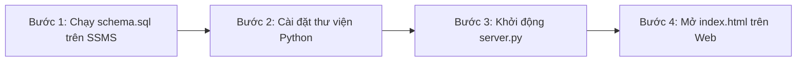

# 🥗 NUTRITFIT - HỆ THỐNG THEO DÕI DINH DƯỠNG, THỂ TRẠNG & GỢI Ý THỰC ĐƠN VIỆT

> **Đồ án / Dự án**: Ứng dụng Quản trị Dinh dưỡng & Vận động Thể chất Cá nhân hóa  
> **Kiến trúc**: Client - Server - Database (Front-end Web SPA + Back-end RESTful API + Hệ quản trị CSDL Microsoft SQL Server + AI Engine)

---

## 📌 MỤC LỤC
1. [Giới Thiệu Tổng Quan & Công Nghệ Sử Dụng](#-giới-thiệu-tổng-quan--công-nghệ-sử-dụng)
2. [Chú Thích Chi Tiết Từng File Trong Dự Án](#-chú-thích-chi-tiết-từng-file-trong-dự-án)
3. [Quy Trình Cài Đặt & Sử Dụng Từng Bước (Tránh Lỗi 100%)](#-quy-trình-cài-đặt--sử-dụng-từng-bước-tránh-lỗi-100)
4. [Các Lỗi Thường Gặp & Cách Khắc Phục Nhanh (FAQs)](#-các-lỗi-thường-gặp--cách-khắc-phục-nhanh-faqs)
5. [Hướng Dẫn Chi Tiết Các Chức Năng Nghiệp Vụ](#-hướng-dẫn-chi-tiết-các-chức-năng-nghiệp-vụ)

---

## 🌟 GIỚI THIỆU TỔNG QUAN & CÔNG NGHỆ SỬ DỤNG

NutriFit là giải pháp công nghệ toàn diện giúp người dùng Việt Nam theo dõi sức khỏe, kiểm soát năng lượng nạp vào/tiêu hao và xây dựng thực đơn bữa ăn gia đình chuẩn khoa học.

### 🛠️ Kiến Trúc Công Nghệ
- **Front-end (Giao diện người dùng)**:
  - HTML5, CSS3 hiện đại, Tailwind CSS (responsive đa thiết bị Desktop/Tablet/Mobile).
  - Thư viện icon vector **Lucide Icons**.
  - Thư viện biểu đồ trực quan hóa dữ liệu **Chart.js** (vẽ tần suất vận động 7 ngày).
- **Back-end (Máy chủ trung gian API)**:
  - Ngôn ngữ: **Python 3**.
  - Framework: **Flask**, **Flask-CORS** (cung cấp chuẩn RESTful API JSON).
  - Kết nối CSDL: **PyODBC** với SQL Server Native Client / ODBC Driver 17/18.
- **Hệ quản trị Cơ sở dữ liệu (DBMS)**:
  - **Microsoft SQL Server (MSSQL)** quản lý qua **SQL Server Management Studio (SSMS)**.
  - Tên CSDL: `NutriFitDB`.
- **Trí tuệ nhân tạo (AI)**:
  - Tích hợp **Google Gemini Flash API** kết hợp **Bộ engine thực đơn dinh dưỡng 7 ngày xoay vòng** độc quyền cho ẩm thực truyền thống Việt Nam.

---

## 📁 CHÚ THÍCH CHI TIẾT TỪNG FILE TRONG DỰ ÁN

Để các thành viên trong nhóm nắm rõ cấu trúc và phân chia công việc, dưới đây là vai trò chi tiết của từng tệp tin trong thư mục `FoodAndHealth/`:

| Tên File | Công nghệ | Vai trò & Tác dụng cụ thể |
| :--- | :--- | :--- |
| **`index.html`** | HTML5, Tailwind CSS, JS, Chart.js | **Giao diện chính (Front-end SPA)** của toàn bộ ứng dụng. Bao gồm: Màn hình Đăng nhập/Đăng ký; Màn hình Khảo sát số đo cơ thể (Onboarding 4 bước); Dashboard quản lý calo & vi chất; Bảng chú thích dinh dưỡng Macro (C-P-F); Khu vực 3 thực đơn bữa trưa/tối; Danh mục bài tập và Biểu đồ cột tần suất luyện tập. |
| **`api.js`** | JavaScript (ES6 Fetch) | **Lớp kết nối Front-end với Back-end (API Client)**. Định nghĩa đối tượng `NutriFitAPI` với các hàm gọi API bất đồng bộ: đăng nhập, đăng ký, lưu hồ sơ thể trạng, sinh thực đơn AI, chọn món ăn, lấy danh mục bài tập, thêm bài tập tùy chỉnh, xóa bài tập tự tạo, ghi nhận buổi tập, lấy thống kê tần suất. |
| **`server.py`** | Python (Flask, PyODBC) | **Máy chủ Back-end RESTful API**. Đóng vai trò cầu nối trung gian quan trọng nhất: lắng nghe tại cổng `http://localhost:5000`, nhận request từ `api.js`, thực hiện kiểm tra tính hợp lệ dữ liệu (validation), truy vấn và lưu trữ an toàn vào Microsoft SQL Server (`NutriFitDB`), kết nối Gemini Flash AI. |
| **`vietnamese_menus.py`** | Python | **Thư viện thực đơn gia đình Việt Nam 7 ngày**. Chứa kho dữ liệu thực đơn phong phú từ Thứ Hai đến Chủ Nhật (bữa trưa no lâu vs bữa tối thanh đạm dễ tiêu) đáp ứng chuẩn 5 món truyền thống, cơ chế xoay vòng thực đơn và sinh prompt cho AI Gemini để không bị lặp món giữa các ngày. |
| **`schema.sql`** | T-SQL (SQL Server) | **Kịch bản khởi tạo Cơ sở dữ liệu**. Tạo CSDL `NutriFitDB`, thiết lập 5 bảng chuẩn có khóa chính, khóa ngoại (`Users`, `UserProfiles`, `Workouts`, `WorkoutLogs`, `MealSuggestions`), nạp sẵn tài khoản mẫu và nạp 18 bài tập vận động chuẩn (Cardio, Gym, Thể thao, Yoga). |
| **`run.bat`** | Windows Batch Script | **Kịch bản chạy nhanh 1-Click**. Tự động kích hoạt máy chủ `server.py` trên một cửa sổ riêng và tự động bật trình duyệt web truy cập `index.html` chỉ với một thao tác nhấp đúp chuột. |
| **`feature.txt`** | Text Document | **Tài liệu đặc tả nghiệp vụ gốc** của đồ án (quy định cấu trúc bài tập: tên, thời gian, calo; chức năng tự thêm bài tập; lưu lịch sử; biểu đồ tần suất vận động; gợi ý thực đơn...). |
| **`storage.js`** | JavaScript | File dữ liệu tĩnh ban đầu (được giữ lại phục vụ đối chiếu kiến trúc). Toàn bộ dữ liệu thực tế hiện tại đã được nâng cấp lưu trữ bền vững vào SQL Server. |
| **`README.md`** | Markdown | Tài liệu hướng dẫn sử dụng và bàn giao kỹ thuật của dự án. |

---

## 🚀 QUY TRÌNH CÀI ĐẶT & SỬ DỤNG TỪNG BƯỚC (TRÁNH LỖI 100%)

> [!IMPORTANT]
> **Nguyên tắc cốt lõi**: Trình duyệt Web chạy trong môi trường Sandbox bảo mật, **không thể kết nối trực tiếp vào SQL Server** nếu thiếu máy chủ trung gian. Vì vậy, **luôn luôn thực hiện đúng thứ tự 4 bước sau đây**:



---

### BƯỚC 1: Khởi tạo Cơ sở dữ liệu trong SQL Server Management Studio (SSMS)
*(Chỉ cần thực hiện 1 lần duy nhất khi cài đặt dự án trên máy mới)*

1. Mở phần mềm **SQL Server Management Studio (SSMS)**.
2. Nhấn nút **Connect** để kết nối vào máy chủ SQL Server của bạn (thường là `.` hoặc `localhost` hoặc tên máy tính, Authentication: *Windows Authentication*).
3. Trong SSMS, nhấn tổ hợp phím **`Ctrl + O`** (hoặc chọn *File $\rightarrow$ Open $\rightarrow$ File...*), duyệt đến thư mục dự án và chọn file **`schema.sql`**.
4. Nhấn phím **`F5`** (hoặc bấm nút **Execute** màu xanh trên thanh công cụ).
5. Quan sát thanh trạng thái phía dưới hiển thị dòng chữ:
   ```text
   Commands completed successfully.
   ```
   $\rightarrow$ CSDL **`NutriFitDB`** cùng toàn bộ 5 bảng và dữ liệu 18 bài tập đã được khởi tạo hoàn chỉnh!

---

### BƯỚC 2: Cài đặt các thư viện Python cho Backend

Mở cửa sổ dòng lệnh (**Command Prompt** hoặc **PowerShell**) hoặc Terminal trong Visual Studio Code tại thư mục dự án, chạy lệnh:

```powershell
pip install flask flask-cors pyodbc requests
```

*Giải thích các gói:*
- `flask`: Tạo web service REST API.
- `flask-cors`: Cho phép giao diện web gọi API nội bộ không bị chặn CORS Policy.
- `pyodbc`: Trình điều khiển kết nối Python với Microsoft SQL Server.
- `requests`: Gửi yêu cầu HTTP đến Gemini Flash AI.

---

### BƯỚC 3: Khởi động máy chủ Backend API

#### Cách A: Dùng kịch bản tự động (Khuyên dùng)
- Nhấp đúp chuột (**Double-click**) vào file **`run.bat`**.
- File kịch bản sẽ tự động mở cửa sổ chạy `server.py` và tự bật trình duyệt web cho bạn!

#### Cách B: Chạy thủ công qua dòng lệnh
Tại thư mục dự án, chạy lệnh:
```powershell
python server.py
```
Khi màn hình xuất hiện thông báo:
```text
NutriFit Backend Server is running at http://localhost:5000 ...
 * Running on http://127.0.0.1:5000
```
$\rightarrow$ Backend đã sẵn sàng kết nối và tiếp nhận dữ liệu!  
*(⚠️ Lưu ý: Giữ nguyên cửa sổ terminal này chạy ngầm trong suốt thời gian bạn sử dụng ứng dụng)*.

---

### BƯỚC 4: Mở Giao diện Web (UI) và Sử dụng
- Mở file **`index.html`** trên trình duyệt (Chrome, Edge, Firefox, Cốc Cốc).
- Đăng nhập bằng tài khoản mẫu có sẵn:
  - **Email**: `demo@nutrifit.vn`
  - **Mật khẩu**: `123456`
  *(Hoặc bạn có thể bấm tab "Tạo tài khoản mới" để đăng ký tài khoản của riêng mình)*.

---

## 🛠️ CÁC LỖI THƯỜNG GẶP & CÁCH KHẮC PHỤC NHANH (FAQS)

### 1. Mở file `index.html` bị báo lỗi "Lỗi kết nối máy chủ"?
- **Nguyên nhân**: Bạn chưa bật `server.py` hoặc cửa sổ terminal chạy Python bị tắt.
- **Cách sửa**: Mở terminal chạy lệnh `python server.py` (hoặc nhấp đúp file `run.bat`) trước khi mở web.

### 2. Khi chạy `python server.py` bị lỗi kết nối SQL Server (`pyodbc.Error`)?
- **Nguyên nhân 1**: Dịch vụ SQL Server chưa được bật.
  - *Khắc phục*: Nhấn phím `Windows + R`, gõ `services.msc`, tìm dịch vụ `SQL Server (MSSQLSERVER)` và bấm **Start**.
- **Nguyên nhân 2**: Máy của bạn đang dùng tên Instance khác (ví dụ: `.\SQLEXPRESS`).
  - *Khắc phục*: Mở file `server.py`, kiểm tra chuỗi kết nối ở đầu file:
    ```python
    # Mặc định server.py tự thử 'localhost' và '.\SQLEXPRESS'
    SERVER = 'localhost' # hoặc r'.\SQLEXPRESS'
    ```

### 3. Nhấn F5 (Refresh) trình duyệt có bị mất dữ liệu không?
- **Không bao giờ bị mất!** Hệ thống đã cấu hình:
  - Tự động ghi nhớ phiên (`session_user`) qua `localStorage`.
  - Tự động tải lại hồ sơ thể trạng và các thực đơn đã chọn trực tiếp từ bảng `UserProfiles` và `MealSuggestions` trong SQL Server.

### 4. Tại sao một số số đo bị bôi đỏ và không cho ấn "Tiếp tục"?
- Hệ thống đã tích hợp **bộ ràng buộc logic sinh học**:
  - Chiều cao bắt buộc từ **100 cm đến 250 cm**.
  - Cân nặng bắt buộc từ **30 kg đến 250 kg**.
  - Độ tuổi từ **12 đến 95 tuổi**.
  - Tỷ lệ tương quan BMI phải nằm trong ngưỡng con người ($11 \le \text{BMI} \le 65$).  
  Nếu nhập sai (hoặc gõ nhầm số âm/quá lớn), ô nhập sẽ viền đỏ và hiện cảnh báo cụ thể.

---

## 📖 HƯỚNG DẪN CHI TIẾT CÁC CHỨC NĂNG NGHIỆP VỤ

### 1. Quản lý Thể trạng & Hồ sơ Cá nhân hóa
- **Tính toán chỉ số khoa học tự động**:
  - **BMI (Chỉ số khối cơ thể)**: Tính theo công thức chuẩn $\text{BMI} = \frac{\text{Cân nặng (kg)}}{[\text{Chiều cao (m)}]^2}$ kèm huy hiệu phân loại theo chuẩn WHO dành cho người châu Á (*Thiếu cân, Cân đối chuẩn, Thừa cân, Béo phì*).
  - **BMR (Chuyển hóa cơ bản)**: Năng lượng tối thiểu duy trì sự sống (công thức Mifflin-St Jeor).
  - **TDEE (Tổng calo tiêu hao hàng ngày)**: Tính theo hệ số hoạt động thể chất (1.2 - 1.55).
  - **Calo mục tiêu cần nạp**: Tự động cân đối theo mục tiêu (Giảm mỡ: thâm hụt 500 kcal, Cân bằng: bằng TDEE, Tăng cơ: thặng dư 350 kcal).
  - **Nhu cầu nước khuyến nghị**: $35\text{ ml} \times \text{Cân nặng (kg)}$.
- **Nút chữ `i` giải thích**: Ở góc trên bên phải mỗi chỉ số đều có biểu tượng chữ `i`. Khi rê chuột vào, khung giải thích chi tiết ý nghĩa và công thức y tế sẽ xuất hiện.
- **Nút "Cập nhật số đo mới"**: Cho phép cập nhật lại cân nặng, chiều cao, mục tiêu bất kỳ lúc nào với tính năng xem trước BMI trực tiếp khi đang gõ.

### 2. Gợi ý Món Ăn Sức Khỏe (Chuẩn Dinh Dưỡng Gia Đình Việt)
- **2 Chế độ theo nhịp sinh học**:
  - ☀️ **Bữa trưa (Ăn no)**: Năng lượng dồi dào (~40% calo ngày), món đạm chắc giúp no lâu làm việc chiều.
  - 🌙 **Bữa tối (Dễ tiêu)**: Năng lượng thanh nhẹ (~30% calo ngày), ưu tiên món hấp/luộc/thanh nhiệt, dễ tiêu hóa giúp ngủ sâu giấc.
- **Cấu trúc 5 thành phần mâm cơm Việt**:
  1. 🍚 Món chính (tinh bột)
  2. 🥩 Món mặn (chất đạm)
  3. 🥣 Món canh (khoáng & nước)
  4. 🥗 Món rau / đồ kèm (chất xơ)
  5. 🍌 Món tráng miệng (hoa quả, sữa chua)
- **Bảng chú thích Macro (C - P - F)**: Phía trên các thực đơn có thanh giải thích trực quan:
  - 🌾 **C (Carbs / Tinh bột)**: Năng lượng vận động.
  - 🥩 **P (Protein / Chất đạm)**: Nuôi cơ bắp & no lâu.
  - 🥑 **F (Fat / Chất béo lành mạnh)**: Hấp thụ vitamin & nội tiết.
- **Nút "🔄 Đổi thực đơn khác"**: Đổi mới 3 gợi ý thực đơn khác nhau khi muốn thay đổi khẩu vị.
- **Nút thứ 4: "Để tôi suy nghĩ / Quyết định sau"**: Bảo lưu trạng thái `Đang chờ`, giữ nguyên vẹn 3 gợi ý ban đầu để chọn lại sau mà không phát sinh thêm món gây rối mắt.
- **Nút "📜 Lịch sử"**: Tra cứu lại toàn bộ các thực đơn đã chọn trong các ngày trước.

### 3. Lập Lịch Tập & Vận Động Thể Lực (Tuân thủ feature.txt)
- **18 Bài tập cài đặt sẵn chuẩn**: Phân loại theo 4 nhóm (*Cardio, Kháng lực Gym, Thể thao, Yoga & Giãn cơ*). Mỗi bài tập đều ghi rõ: **Tên**, **Thời gian (phút)**, **Calo đốt (kcal)**.
- **Thêm hoạt động tự tạo**: Cho phép người dùng tự tạo bài tập riêng của mình và lưu trữ vào SQL Server.
- **Nút Xóa bài tập tự tạo**: Người dùng có thể xóa bài tập do chính mình tạo ra (các bài tập mặc định của hệ thống được bảo vệ không thể xóa nhầm).
- **Ghi nhận buổi tập**: Bấm *"Ghi nhận tập"* để lưu vào lịch sử thời gian thực.
- **Biểu đồ cột trực quan (Chart.js)**: Thống kê tần suất 7 ngày gần nhất, linh hoạt chuyển đổi giữa 3 thước đo:
  - ⏱️ Thời gian tập (phút)
  - 🔥 Calo tiêu hao (kcal)
  - 📊 Số buổi tập
- Cung cấp 4 thẻ chỉ số nhanh: Tổng số buổi, Tổng số phút, Tổng calo đốt, Số ngày hoạt động trong tuần.